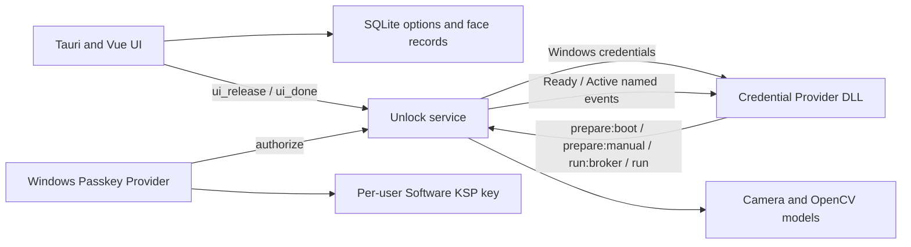

# Current Architecture

This document describes the active product architecture. Removed experiments are listed only as constraints and do not belong to the build.

## Components

### UI

The UI owns enrollment, settings, deployment, logs, updates, and Passkey management. It stores application state in SQLite and coordinates camera ownership before enrollment or verification.

### Credential Provider

The DLL runs inside Windows authentication hosts. It advertises a tile only in configured scenarios, requests recognition from Unlock, receives a matched account credential, and serializes it for Windows.

Face authorization is single-use. `GetSerialization` requires both a ready credential and an unconsumed face authorization; successful serialization consumes that authorization, so a repeated call cannot package the same recognition result again.

Credential Provider APIs do not expose Chromium's prompt message. Broker classification therefore uses documented scenario flags, Win32 owner/root-owner context, explicit safe/unsafe text signals when available, private-window markers, registry policy, and the WebAuthn monitor state.

A website's page title, including “登录 -” or “Sign in -”, is not evidence that the browser requested a passkey. The browser password-fill fallback is a guarded heuristic, not an authenticated statement of the browser's intent: it requires an allowlisted browser, a Ready and inactive WebAuthn monitor, a non-private window, and the explicit registry switch. An Active WebAuthn event or an explicit passkey signal vetoes it. The provider cannot reliably distinguish every password-fill prompt from a passkey prompt through `ICredentialProvider` alone; unknown requests outside this narrow opt-in policy remain on Windows authentication.

Chrome places its reauthentication message in `CREDUI_INFO.pszMessageText` when it calls `CredUIPromptForWindowsCredentials`. The public Credential Provider callbacks do not receive `CREDUI_INFO`; the local `Microsoft-Windows-CredUI` diagnostic manifest exposes prompt start/stop events without that message. A stock browser therefore cannot provide an authenticated password-fill intent to this DLL. The browser broker tile uses an explicit “这是密码填充，使用人脸验证” command link as the user-supplied intent. In broker password scenes the FaceWinUnlock tile is the default selection, the link renders in both the tile list and the selected view, and the link holds the initial focus, so pressing Enter activates the link instead of the host's cancel button. Pressing OK or Enter while the face tile is selected submits that tile and is treated as the same explicit intent: `GetSerialization` requests the same manual broker run that the link click starts. Passive activity still never starts recognition — mouse movement, keyboard input on other tiles, and tile selection alone remain inert. The WebAuthn monitor must remain Ready and inactive before starting and submitting recognition; failure returns to Windows authentication. This path does not inspect or alter the protected dialog or PIN.

An experimental host-window sampler is available only when the existing HKLM registry root has `CREDUI_INTENT_MODE` set to the exact `REG_SZ` value `observe`. The missing/default value is off; `auto` is not implemented and does not enable sampling. After credential `Advise`, the sampler calls the official credential events `OnCreatingWindow` method outside the events mutex, then records a bounded, twice-sampled owner/root-owner relationship with PID, process creation time and WTS session. It reads no window title or controls and starts no IPC or recognition. These snapshots do not prove HWND lifetime or browser intent and cannot authorize credentials. The experimental implementation and remaining gates are tracked in [the intent bridge design](credui-intent-bridge-design.md).

`Unlock/src/credui_intent.rs` is an offline library model for a future request/ownership protocol. The Unlock service binary does not import it, and no current named pipe sends Begin/Arm/Claim messages. Its tests do not change Credential Provider behavior or enable automatic recognition. The `CredUIProbe` harness is similarly limited to synthetic fixtures; it cannot start or attach to browsers.

For the primary logon/unlock scenes, the DLL selects one per-session trigger policy:

- `prepare:boot` is claimed only once per Windows boot, for the first `CPUS_LOGON` candidate. The claim is stored as a non-sensitive per-boot marker under `%ProgramData%\facewinunlock-tauri\boot-sessions` so LogonUI or service restarts do not turn a later Win+L into an automatic unlock. The first-session boundary is intentional: Windows may report the power-button or boot-time interaction as recent input before the user has reached the machine.
- `prepare:manual` is used for `CPUS_UNLOCK_WORKSTATION`, later logon candidates, and all uncertain cases. Recognition still requires the existing low-level input hook.
- All CREDUI sessions use `prepare:manual`, so a run from a previous dialog cannot arm delayed recognition in a later dialog. Browser broker `run:broker` requires the explicit command-link click; other supported CredUI scenarios use their existing input trigger. The legacy policy remains only to accept older provider messages and does not apply to the official Passkey provider.

The DLL never synthesizes keyboard/PIN input and never sends an automatic `run` command. In boot mode, Unlock starts the configured delay only after a credential client is connected; it performs at most three automatic attempts, then changes that session to input-only mode. A manual input cancels any pending boot timer.

### Unlock Service

The scheduled task starts a SYSTEM supervisor and worker. The worker owns camera recognition, lock-screen prewarm, WebAuthn event monitoring, the Passkey face gate, and automatic locking.

The service does not call `LockWorkStation` from Session 0. It launches a one-shot helper under the active WTS user token on `winsta0\default`, then confirms the session lock flag.

### Passkey Provider

The optional MSIX is available only on Windows 11 24H2+. It creates and owns the WebAuthn credential key. FaceWinUnlock provides a one-operation authorization decision but never exports or substitutes a Windows Hello private key.

## IPC

| Name | Participants | Purpose |
|---|---|---|
| `MansonWindowsUnlockRustServer` | Credential Provider to Unlock | Session policy (`prepare:boot`, `prepare:manual`; `prepare:legacy` accepted for older providers) and explicit `run:broker` or input-triggered `run` |
| `MansonWindowsUnlockRustUnlock` | Unlock, Credential Provider, UI | credentials, release and camera coordination, health/exit control |
| `FaceWinUnlockPasskeyFaceAuth` | Passkey plugin to Unlock | one face authorization request |
| `Global\FaceWinUnlockTauriBrokerRouteMutex` | Unlock and Credential Provider | orders Passkey face authorization against final generic broker serialization |
| `Global\FaceWinUnlockTauriWebAuthnReady` | Unlock to Credential Provider | monitor is healthy and contract-validated |
| `Global\FaceWinUnlockTauriWebAuthnActive` | Unlock to Credential Provider | at least one tracked WebAuthn transaction is active |

## Broker Decision Order

1. Active WebAuthn transaction: skip the generic Credential Provider.
2. Explicit passkey, security-key, WebAuthn, FIDO2, or PIN-setup signal: skip.
3. Settings/biometric enrollment/private browser: disable unknown fallback.
4. Explicit password manager, reveal/show password, or fill-password signal: offer the browser face tile with its manual command link only while the WebAuthn monitor is Ready and inactive.
5. Unknown browser request: offer the same manual tile only for Chrome, Edge, Brave, Opera/Opera GX, Vivaldi, Chromium, or 360; monitor Ready; monitor not Active; non-private; `CREDUI_BROWSER_PASSWORD_FILL=1`. A website login-page title does not veto this fallback.
6. Everything else: return `E_NOTIMPL` to Windows.

The Active check is repeated in `SetUsageScenario`, `Advise`, before pipe connection, before `prepare`, during recognition, and before credential submission. This closes the race where a WebAuthn transaction begins after initial enumeration.

The official Passkey provider also has its own face-authorization pipe, so the WebAuthn monitor alone cannot cover the interval before the provider signs. Unlock marks the browser command-link trigger as `run:broker`, stops that recognition if a Passkey face request arrives, and does not publish a matched credential until the route check completes. Unlock holds `Global\FaceWinUnlockTauriBrokerRouteMutex` while a Passkey face decision is pending; broker `GetSerialization` takes the same mutex without waiting. A busy, missing, inaccessible, or abandoned mutex discards and zeroizes the broker credential and refreshes the CredUI choices so Windows can use its native PIN. Primary logon/unlock serialization is outside this broker-only mutex.

## Camera Lifecycle

- Lock-screen prewarm opens the configured camera before the first `run` where possible.
- Unlock reads the saved camera selection on a recognition `prepare` event and again when each recognition request starts. A changed selection closes any old prewarmed capture before opening the selected camera; an in-flight request continues on its current camera.
- A camera is considered usable only after warm-up frames arrive. If the configured camera cannot open or produce frames, Unlock tries other indices marked valid in the saved `cameraList`; this fallback is temporary and does not rewrite the user's selected camera. Each later open tries the configured camera first again.
- Boot-delay mode may start recognition without user input, but only after the primary session policy is explicitly marked `prepare:boot` and the credential client is connected.
- Boot-delay mode is bounded to three automatic attempts; exhaustion arms the existing mouse/keyboard path and does not inject credentials.
- No enabled face records means no prewarm.
- Prewarm releases after 45 seconds without a request.
- UI camera operations send `ui_release`; all completion/error paths send `ui_done`.
- Manual PIN unlock sends release and blocks same-session prewarm until credential-client transition confirms a new session.
- Auto-lock skips camera checks while the workstation is already locked.

## Data And Trust

- Face records, options, and configured Windows credentials remain local.
- The incremental updater verifies the raw release manifest with the reviewed Minisign public-key ring before parsing it, and rechecks staged asset hashes before replacement. Older clients without this verifier retain their previous behavior.
- Windows account passwords are stored as machine-DPAPI ciphertext with per-install random entropy held under an HKLM registry key whose protected DACL grants access only to SYSTEM and Administrators. The UI writes ciphertext and never loads stored passwords into Vue state; Unlock decrypts only when loading credentials for recognition.
- On upgrade, the elevated UI migrates legacy plaintext `faces.user_pwd` values in one SQLite transaction, validates existing ciphertext, enables secure deletion, and vacuums old database pages. Migration failure stops UI initialization so records are not silently rewritten or discarded; the Unlock service continues to accept legacy values until migration succeeds.
- Rust-owned plaintext password buffers are overwritten before migration buffers, Unlock credential records/cache entries, parsed Credential Provider pipe data, and temporary UTF-16 password buffers are released. Copies held by SQLite, WebView/JavaScript, Windows APIs, or the operating system are outside this guarantee.
- The generic Credential Provider briefly handles account credentials to log on; it must never log serialization bytes or secret values.
- Passkey private keys are per-user Software KSP keys. Metadata backup is under `%ProgramData%\facewinunlock-tauri\PasskeyBackup`.
- Ordinary RGB face recognition is a convenience layer, not equivalent to Windows Hello biometric assurance.

## Removed Routes

- UI Automation and protected-dialog control inspection
- Keyboard/PIN injection and blind submission
- Browser extension WebAuthn interception and local HTTP signing
- Capturing or reconstructing Windows Hello passkey private keys
- Credential Provider DComp/D2D lock-screen animation

Upgrade/uninstall code may still delete historical files or registry values for these routes. Those cleanup references are intentional migration tombstones.

## Management-App Login

The management app's optional login is separate from Windows Credential Provider authentication. Both `onlyOpenApp` and `showApp` require login on process startup; `showApp` additionally requires login when the main window is explicitly shown from the tray or by a second-instance launch. Ordinary focus changes do not count as reopening the app. Time-limited login continues to expire according to its configured interval.

When app login is enabled, the login page may verify the current face against enabled local `.face` templates. The Tauri backend reads templates and thresholds from the local database, rejects ambiguous multi-face frames, and follows the same `livenessEnabled` option as unlock verification: with liveness enabled it requires the local passive liveness model at the configured threshold (floored at 0.30); with liveness disabled it relies on template matching alone, matching the lock-screen unlock policy. Camera/model/database failures leave password login available. This app-level convenience check does not submit Windows credentials or replace Windows Hello assurance.
