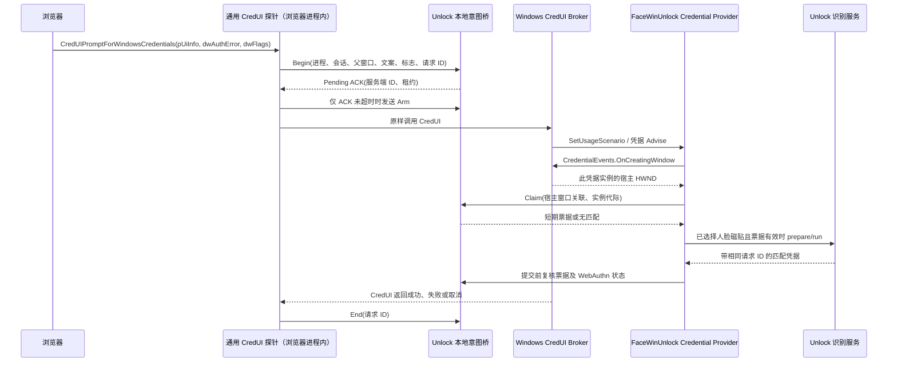

# CredUI 密码填充意图桥接方案（设计稿）

状态：安全原型阶段，未安装，自动路径未实现。仓库已有离线意图状态机、测试专用 CredUI 探针和默认关闭的 Provider 窗口元数据采样；三者尚未连入产品识别路径。当前产品仍以手动命令链接和 Windows 原生验证为准。

## 2026-10-05 实现状态

### 2026-10-04 installed-log finding

The two user tests were separated by the Provider session timestamps and matched to the Unlock service's UTC timestamps (10:48 UTC corresponds to 18:48 China Standard Time). In the first session, the Provider classified the request as `BrowserPasswordFill`, observed WebAuthn Ready and inactive, received an input-hook event, sent `run`, and then received a matched credential. In the second session, a new Provider request sent `prepare` but no `run`; Unlock nevertheless scheduled delayed recognition after the recent-unlock grace period, then matched and returned a credential at the time the dialog was closed. The service's legacy delay policy retained `dll_run_received` from the earlier session, so a prior `run` could arm recognition in the later CredUI session.

Unlock also logged a separate Passkey face-authorization request in the same second as each generic broker result. The logs do not prove whether the two requests came from one browser operation, but they do show that `BrowserPasswordFill` plus an inactive WebAuthn snapshot is not authenticated intent. Keep the explicit command-link trigger and the WebAuthn veto; do not enable automatic broker recognition until route ownership is connected and installed passkey/password overlap tests pass.

The current provider now sends `prepare:manual` for every CredUI session. The existing browser command link is the only browser broker trigger; other supported CredUI prompts retain their input trigger. This prevents a prior dialog's `run` from enabling delayed recognition in a later dialog. The installed log predates these local changes, so the change still needs an installed-build repeat of both user tests. The log confirms face-match and credential serialization events, but does not establish why Chrome repeated its PIN UI.

- `Unlock/src/credui_intent.rs` 是离线状态模型，不含 IPC、摄像头或浏览器 API 连接；新实例默认 `Off`。其单元测试只证明状态转换和所有权约束。
- `CredUIProbe/` 目前只允许运行仓库内合成夹具。它验证 x64 调试寄存器采样、有限文本读取和清理行为；不会启动或附加 Chrome、Edge 或其他浏览器，也不证明真实 `CredUI_INFO` 布局、标志映射、提示模板或窗口关联。
- Server 的 `CREDUI_INTENT_MODE=observe` 仅记录 Credential Provider 官方回调取得的窗口及进程元数据。它没有请求关联 IPC、票据、自动识别或授权效果。
- 生产代码没有安装 Hook、修改系统 DLL、向浏览器注入代码或启用 `auto`。不允许把合成夹具结果当作浏览器/Windows 兼容证据。

## 目标与不可逾越的边界

- 对调用 `CredUIPromptForWindowsCredentialsW/A` 的浏览器，尽量在密码填充时自动开始 FaceWinUnlock 识别。所有受支持浏览器复用同一套按系统 API 导出名工作的探针；每个目标进程仍需加载探针，不维护各浏览器私有函数的偏移。
- 识别不覆盖 Passkey、设置 PIN、UAC、私密窗口或无法证明属于当前弹窗的调用。未知情况保留现有手动人脸链接或 Windows PIN。
- 不读取、修改或提交 PIN、密码、凭据序列化、WebAuthn 请求或受保护对话框控件；不使用 UI Automation。
- CredUI API 拦截只能观察调用者提供的 `CREDUI_INFO` 显示文字。它比网页标题更贴近本次调用，但仍不是 Windows 认证的“密码填充”类型。任何由文字推断的自动策略都必须默认关闭并允许立即关闭。
- 不声称覆盖所有浏览器：未调用该 CredUI API、未提供可验证父窗口或未匹配已验证文案模板的请求保持手动路径。

## 组件与数据流

### 1. 一套通用探针，按进程加载

选定的首个原型是 `CredUIProbe.dll` 和测试启动器 `CredUIProbeHost.exe`。启动器在隔离测试镜像中启动指定浏览器主进程并加载探针；探针以导出名定位 `credui.dll!CredUIPromptForWindowsCredentialsW/A`，保持目标函数相同的签名与调用约定，通过 trampoline 原样调用原函数。可参考 Microsoft Detours 的通用实现；本设计没有向仓库添加该依赖或注入代码。

这是一套代码用于多个浏览器，并不是在 Unlock 进程里 Hook 一次就影响所有浏览器。每个目标进程都有自己的地址空间，需要独立加载同一探针。第一版只验证 x64 和显式测试进程；x86、ARM64、已运行进程的安全附加和浏览器的进程保护是后续兼容工作。浏览器启动可能复用已有主进程，因此测试启动器必须确认真正被观察的 PID，不能把“启动命令成功”当成已安装 Hook。产品阶段的进程发现依赖浏览器清单数据与映像校验，加载失败返回未观察状态；不附加到 LogonUI、CredentialUIBroker 或其他系统验证宿主。

探针仅在调用原函数前复制受长度约束的 `CREDUI_INFO.pszMessageText`、`hwndParent`、`dwFlags`、`dwAuthError`，生成随机调用 ID 并发送 Begin；原函数返回后发送 End。它不改参数、返回值或认证缓冲区。初始化、管道 I/O、等待和复杂清理不在 `DllMain` 中执行；调用包装器有线程级重入保护，W/A 内部互调也只能登记一个最外层调用。Begin 登记采用有上限的等待，初始预算 20 ms；它只创建不可领取的 Pending。只有预算内收到 ACK，探针才向同一连接发送一次 Arm，然后原样调用 CredUI；ACK 超时路径永不发送 Arm。服务端只有接收有效 Arm 后才允许 Claim，因此迟到 ACK 不会意外启用自动路径。Arm 未到达、租约过期或 Claim 先到时按未匹配处理，Provider 不等待迟到事件。该预算需要实测，不能视为已测性能。

修改系统 `credui.dll` 是同一事件协议的**独立实验备选**，并非本原型已经解决的安装方法。磁盘文件变更还涉及各架构副本、已映射进程、签名、完整性策略、导出兼容和系统更新；“没有 WRP”只消除一个障碍。若选择此备选，先在原保护配置的可恢复测试镜像中证明实际加载的模块路径与导出、原函数透明转发、取消/错误返回和恢复过程；任一项失败即停止该候选，不能据此承诺全局覆盖。Edge 或其他浏览器是否使用该 API 仍以实测为准。

### 2. 本地意图桥与请求关联

在 Unlock 服务内增加版本化的本地桥接端点，不引入云端。桥接服务用操作系统取得的管道客户端 PID、进程创建时间、登录会话、用户 SID、映像路径和签名检查调用者；不信任消息中自报的进程名。`GetNamedPipeClientProcessId` 可用于取得客户端 PID。管道拒绝远程客户端，访问控制限于目标登录用户、SYSTEM 和必需的本地验证宿主，并按 WTS 会话隔离请求。Provider 查询端也校验实际系统宿主映像和会话，不能只判断文件名；客户端核验管道服务端实际为预期 SYSTEM 服务进程，不能仅信任管道名称。浏览器清单是**数据配置**，不是每个浏览器一份 Hook；未验证的浏览器只能走手动路径。

进程身份校验能排除其他程序自报 Chrome，但不能证明浏览器进程中的消息一定由可信探针生成，也不能证明显示文案的真实用途。本设计针对正常浏览器流程的误触发；不把同用户恶意代码已能控制浏览器进程的情形描述为已解决的认证边界。

Begin 保存一个仅在内存存在的 Pending 请求：客户端调用 ID、服务端 `request_id/generation`、已认证连接 ID、真实调用进程实例、会话 ID、父 HWND 及其所属进程、开始时间、`api_flags`、重试错误码和文案分类结果。服务端为每次 Begin 分配代际；Arm 必须绑定同一连接、服务端 ID 和未到期租约，不能复活终结状态；End 也只能撤销该连接拥有的请求。原文只在内存中分类，不能写日志；End、连接断开、进程退出或超时立即撤销。重复 Begin/Arm 不能延长租约或重置状态。若 `hwndParent` 为空，或同一父窗口出现多个未终结请求（含 Pending），自动判定失败。

Provider 现有 `broker_context` 以全局前台窗口为起点，只汇总前台、owner 和 root-owner 的**标题与进程名**；它不能绑定某个凭据实例。`SetUsageScenario` 只做粗分类和否决。等到 credential 的 `Advise` 提供事件接口后，调用正式的 `ICredentialProviderCredentialEvents::OnCreatingWindow` 获取该凭据的宿主 HWND，以此 HWND 为固定锚点解析 owner/root-owner 关系；前台切换不得换掉锚点。调用失败、空 HWND、宿主换代或生命周期失效均拒绝 Claim 并撤销旧票据。宿主 HWND、所属 PID/进程创建时间、WTS 会话以及 Provider/credential 实例代际一起发送给桥。此操作只取得正式接口提供的窗口身份，不读取对话框控件。

只有调用方父 HWND 在这个固定宿主锚点的可验证窗口关系中精确相等，窗口所属进程实例和会话一致，且只有一个仍活动的候选调用，桥才返回绑定该凭据实例的观察票据。仅凭窗口标题、进程名或时间相近不返回票据。Provider 标志单独记为 `provider_flags`：当前日志是 `0x250`，公开 Chromium 调用的 `api_flags` 是 `0x200`；不能要求原始数值相等。P0 必须验证 Windows 的标志转换关系，策略只接受验证过的语义组合，未解释的组合维持手动路径。

`OnCreatingWindow` 文档只保证可以取得宿主父 HWND，没有保证其 owner 链包含浏览器的 `CREDUI_INFO.hwndParent`，Windows 也没有把探针的随机 ID 传给 Provider。因此这种关联仍是需验证的保守关联。第一阶段必须实测 Chrome 和 Edge 的窗口关系、同父窗口多次调用和前台切换。匹配不到、父窗口或宿主窗口被销毁/复用、候选不唯一、或者无法证明 Claim 来自本次宿主实例时，不发票据，维持手动路径；不能放宽为猜测。

### 3. 分类和 FaceWinUnlock 生命周期

自动识别仅适用于已验证浏览器映像、已验证语言与版本的**完整密码填充提示模板**。模板必须在填充、查看、导出和编辑保存密码等操作中具有已验证的用途区分度；若不同操作共用同一文案，该模板不得放行自动填充。模板只允许验证过的固定字面文本和唯一、长度受限的站点槽位；站点不参与类别判断，不用宽泛任意字符串通配来补齐模板，解析歧义或文案变化回到手动链接。`dwAuthError != 0` 的输错 PIN 重试不自动再次启动识别。显示文字属于调用方，可被其他程序仿造，所以它只是受限的意图证据，不是 Windows 提供的认证标签。

API 取消、错误返回或后续调用出现 `dwAuthError != 0` 后，同一调用进程实例与父窗口进入 `ManualRequired`，在该窗口存续期间不再自动识别；显式人脸链接可单次发起手动任务，但不清除这项抑制。新调用 ID、重选磁贴或重新枚举不能清除抑制；窗口销毁后也必须核验新的窗口生命周期，不能只看复用的 HWND 数值。`dwAuthError == 0` 不证明这是首次尝试，End 成功不证明浏览器验证成功。P0 必须记录非敏感的 `End → Begin` 状态与回调顺序；若目标浏览器将错误后的重试作为新的无错误调用，且没有可验证的失败信号，不能放行其自动策略，也不能靠固定冷却时间猜测新意图。

这项状态只防止 FaceWinUnlock 自己重复启动。探针原样转发调用与返回值，不能改变浏览器自身反复打开原生 PIN 框的控制流；取消和错误 PIN 的两次测试仍需分别检查浏览器行为与 FaceWinUnlock 任务次数，不能把减少识别次数当成解决原生弹窗循环或光标问题。

`SetUsageScenario` 和 Provider `Advise` 先执行现有场景与 WebAuthn 否决；credential `Advise` 取得固定窗口锚点后才允许 Claim。开始 `run`、收到凭据和 `GetSerialization` 前，都复查票据与实例代际、固定窗口关系，以及监视器 Ready 且不 Active。Passkey/安全密钥明确线索与 PIN 设置始终否决。

私密模式单独使用 `Normal / Private / Unknown` 状态。CredUI 参数没有私密模式字段；当前标题检查只能提供私密窗口的否决线索，缺少私密标记不能证明 `Normal`。未取得独立且验证过的普通模式证据时，状态必须是 `Unknown`，自动路径不启用。该证据来源尚未解决，是产品自动放行前的阻断项；不能为了提高覆盖率把标题不命中当成普通窗口。

自动 `run` 还要求 FaceWinUnlock 磁贴已经选中，因此不保证弹窗一出现就启动；保留 Windows 的默认磁贴和提交控制，不抢默认选择、不反复 `CredentialsChanged`。可执行的撤销信号限于 `SetDeselected`、`UnAdvise`、End、窗口/进程失效和监视器故障：选中原生 PIN 磁贴引发去选中时撤销，但不能保证在没有这些回调时观察到用户开始输入 PIN。每次调用至多一次自动尝试；去选中、错误或超时后不可因重新选中、重新枚举、鼠标或键盘活动自动重启。显式点击手动链接仍按现有手动规则处理。

`prepare/run` 和返回凭据应升级为带所有权的版本化管道协议，拒绝前次弹窗的凭据。当前 Unlock 的识别和匹配凭据状态有共享字段，**仅给消息加 ID 不足以保证并发隔离**。第一版使用服务端独占识别所有者：`route + connection_id + request_id + generation + session_id`，route 为 `PrimaryLogon`、`GenericBroker` 或 `Passkey`。一个仲裁器管理相机和任务生命周期，结果产生、缓存与发送均检查同一所有者；撤销只作用于所属任务。一个相机只允许一个活动所有者，不排队复用前次人脸结果。旧手动协议也必须遵守仲裁，不能绕过所有权。第二个 broker 请求不自动识别，使用 PIN 或在相机空闲后显式发起手动识别；Passkey 保持独立授权协议，不能取走 generic broker 的结果。取消后推进代际，迟到结果即使请求 ID 相同也拒绝。

撤销和输出许可在服务端状态机中串行裁决，Provider 在交回序列化前再检查本地选中状态与代际。已交给 Windows 的结果不能由桥追溯收回；验收必须覆盖取消与结果同时到达的竞争，不能把 End 到达后的清理描述为能撤回已经完成的原生提交。

新旧 Provider/Unlock 版本不兼容时禁止自动路径；原手动协议仍可用时保留手动链接，否则只使用 Windows PIN。全局开关分 `off`、`observe`、`auto`，默认 `off`；`observe` 只记录非敏感的命中/拒绝原因和计数，不启动相机。自动票据绑定最多一次识别尝试，识别超时即撤销；不能通过客户端心跳无限续期。

## 最小协议与实现切片

所有请求使用长度受限、版本化的消息；IPC 失败不能阻塞 Windows 宿主 UI 线程。下列是接口草案，不是已实现的 API：

| 消息 | 必需内容 | 服务端动作 |
|---|---|---|
| `Begin` | 协议版本、客户端调用 ID、父 HWND、W/A 形式、`api_flags`、`dwAuthError`、受限文案 | 核验真实调用进程与连接；只在内存内分类；创建不可领取的 Pending，ACK 返回服务端请求 ID/代际及租约 |
| `Arm` | 同一连接、服务端请求 ID/代际 | 只将未到期 Pending 转成可 Claim 的 Observed；重复或迟到 Arm 不延长租约 |
| `End` | 同一连接的调用 ID、原函数返回状态 | 撤销该连接拥有的调用及票据；取消对应识别。返回成功不代表浏览器后续验证一定成功 |
| `Claim` | Provider/credential 实例代际、OnCreatingWindow 宿主 HWND/进程、owner 关系、`provider_flags` | 精确匹配唯一活动调用；返回绑定实例的一次性观察票据或拒绝原因 |
| `Validate` | 票据、实例代际、相同宿主锚点的窗口上下文 | 复核生命周期、进程实例、唯一关联、监视器与策略；不得扩大原权限 |
| `Run / Cancel` | 票据、完整识别所有者 | 取得/释放独占相机所有者；取消后拒绝迟到结果 |

桥维护 `Pending → Observed（已 Arm）→ Claimed → Recognizing → Completed` 状态；任意未终结状态均可进入不可恢复的 `Revoked`。Completed/Revoked 保留本次连接生命周期内的终结记录，重复/乱序消息不得复活请求。`ManualRequired` 是另一个按调用进程实例和父窗口生命周期保存的抑制状态，不随请求连接重建清除。Provider 重用、`SetDeselected`、`UnAdvise`、End、连接断开、窗口/调用进程退出、桥/服务重启或租约到期都终止旧请求状态。桥/服务重启后自动策略保持关闭或观察，不能通过丢失抑制记录恢复自动运行。End 丢失不能让活动请求永久保留：桥持有调用进程句柄监听退出，未被 Claim 的 Observed 只在短窗口内可领取；已领取的票据受识别超时约束。时间只限制寿命，不能代替窗口关联。

实现顺序及文件责任：

| 切片 | 计划位置 | 可独立证明的结果 |
|---|---|---|
| P0：探针夹具 | `CredUIProbe/` 测试组件和脚本 | 4 个合成夹具验证调试寄存器恢复、模块卸载、异常退出和调用边界；未验证 Chrome/Edge 或其他浏览器 API 路径 |
| P1：离线状态机 | `Unlock/src/credui_intent.rs` | 14 个单元测试覆盖默认关闭、Begin/Arm/End、错误 PIN/取消/超时抑制、唯一 Claim、窗口生命周期、WebAuthn veto 和识别所有权；尚未接入 Unlock 服务 |
| P2：只观察采样 | `Server/src/credui_observation.rs`、`Server/src/CSampleCredential.rs` | 仅精确 `REG_SZ observe` 采集官方 OnCreatingWindow 主机 HWND 关系元数据；未与 CredUI 调用关联，不启动识别 |
| P3：单请求自动流程 | `CSampleProvider.rs`、`CSampleCredential.rs`、`CPipeListener.rs`、双方 `Pipe.rs`、Unlock 识别所有者 | 选中磁贴且票据有效时一次 `run`；取消与代际阻止迟到提交 |
| P4：安装与配置 | `UI/src-tauri/src/modules/init.rs`、安装脚本、配置页面 | 默认关闭、关闭后不再附加、已加载探针停止发布新请求、组件版本一致、原生验证始终可用 |

P0 的浏览器调用路径仍未验证。真实 API 入口位于调用方进程；一个进程内的 Hook 不会自动覆盖其他浏览器进程，也没有 Credential Provider 回调可直接取得 `CREDUI_INFO`。若要继续实验，必须单独设计经过签名校验、隔离测试配置和失败清理验证的浏览器启动器；不得复用生产浏览器配置或替换 Windows 系统文件。即便读到调用方提供的文案，它仍是可变显示文本，不能单独作为授权凭据。

P2 的宿主关联与私密模式证据、P3 的全部识别所有权隔离均是进入 `auto` 的前置门槛；任一项没有证明，就只交付 `observe` 和已有手动路径。探针正在执行原生调用时不得强行卸载；关闭功能先撤销票据并停止新发布，模块退出清理随浏览器安全退出完成。

## 验证顺序与停止条件

1. **透明探针可行性阶段**：在可恢复的测试镜像中验证实际加载模块和可恢复性，观察 Chrome、Edge 以及至少一种其他 Chromium 浏览器的 CredUI 入口、W/A 形式、父 HWND 和 credential OnCreatingWindow 宿主窗口关系。分别测试填充、查看/导出/编辑保存密码、Passkey、错 PIN 后的 `End → Begin` 重试、取消、并发窗口和前台切换；不持久化密码、PIN、完整文案或网站地址。模板被其他用途复用、错误后的重试无法识别、Edge 不走该 API 或不能建立宿主关联，均列为手动覆盖，不能宣称自动覆盖。
2. **`observe` 阶段**：检查 Begin/Arm/End、双向进程身份校验、父窗口精确匹配、连接断开/窗口复用、重复/乱序消息、崩溃和超时清理。故障注入覆盖 Begin 已处理但 ACK 丢失/迟到、Claim 先于 Arm、Arm 过期：零次可用票据。验证 Normal/Private/Unknown 证据来源；Unknown 必须拒绝自动放行。任何一例 Passkey/UAC/设置 PIN/私密窗口/其他密码操作被判为可自动填充，停止推进并修正规则。
3. **隔离自动阶段**：只对已验证的模板和浏览器启用 `auto`。确认同一次弹窗最多一次自动 `run`；输错 PIN 的重试和取消不留下待执行请求，同父窗口的新调用不能绕过 ManualRequired；WebAuthn Active 或 Ready 丢失后不会提交凭据；未匹配的浏览器可继续使用手动链接与 PIN。单独记录浏览器是否仍重复弹 PIN、光标是否恢复，不能以服务端状态机测试代替该安装环境验收。
4. **系统升级复测**：每个 Windows 版本、浏览器大版本及本地化模板变化均回到 `observe`。探针失效、导出行为改变、窗口关联不稳定或无法原样调用 CredUI 时，自动关闭，不替换系统恢复路径。

自动阶段的放行条件是：目标浏览器的正例能稳定匹配；全部负例零次自动 `run` 和零次 FaceWinUnlock 凭据提交；取消和错误 PIN 不产生无界重试；Windows PIN 始终可用。代码测试、隔离镜像测试与真实安装环境验收分别报告。

## 当前结论

本轮实现与原设计稿的差异：`CredUIProbe` 仅保留自包含合成夹具；通用浏览器启动/附加入口已从命令行移除，因此 P0 真实浏览器验证仍未完成。`IntentBridge` 是库内模型，P1 尚未进入 Unlock 服务或现有命名管道。两项都不能改变当前产品路径。

这是一套**复用 CredUI API 探针**的设计，可减少浏览器种类带来的 Hook 代码维护，但仍需按进程加载，并维护架构、浏览器/语言模板和 Windows 兼容验证。它不能保证所有浏览器都使用该 API，也不能把显示文字提升为真正的类型化信号。若要求对所有浏览器既全自动又可证明“这是密码填充”，需要浏览器或 Windows 提供受支持的类型化意图与实例关联；本文引用的 Credential Provider/CredUI 接口没有这些字段。宿主关联或私密模式证据未通过前，方案只能停在观察阶段。现有显式人脸链接是未知场景的长期回退路径。

参考：[CredUIPromptForWindowsCredentials](https://learn.microsoft.com/en-us/windows/win32/api/wincred/nf-wincred-creduipromptforwindowscredentialsa)、[ICredentialProvider::SetUsageScenario](https://learn.microsoft.com/en-us/windows/win32/api/credentialprovider/nf-credentialprovider-icredentialprovider-setusagescenario)、[ICredentialProviderCredentialEvents::OnCreatingWindow](https://learn.microsoft.com/en-us/windows/win32/api/credentialprovider/nf-credentialprovider-icredentialprovidercredentialevents-oncreatingwindow)、[GetNamedPipeClientProcessId](https://learn.microsoft.com/en-us/windows/win32/api/winbase/nf-winbase-getnamedpipeclientprocessid)、[Microsoft Detours 使用说明](https://github.com/microsoft/Detours/wiki/Using-Detours)、[Chromium 密码管理器的 Windows 调用](https://chromium.googlesource.com/chromium/src/+/master/chrome/browser/password_manager/password_manager_util_win.cc)。
